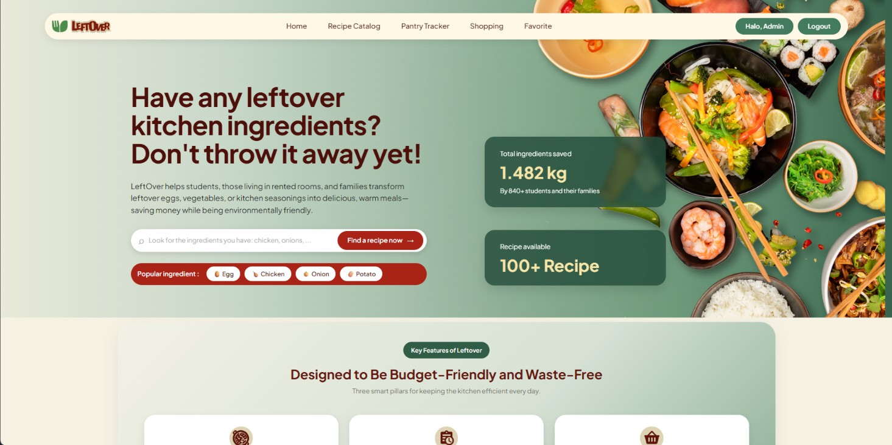
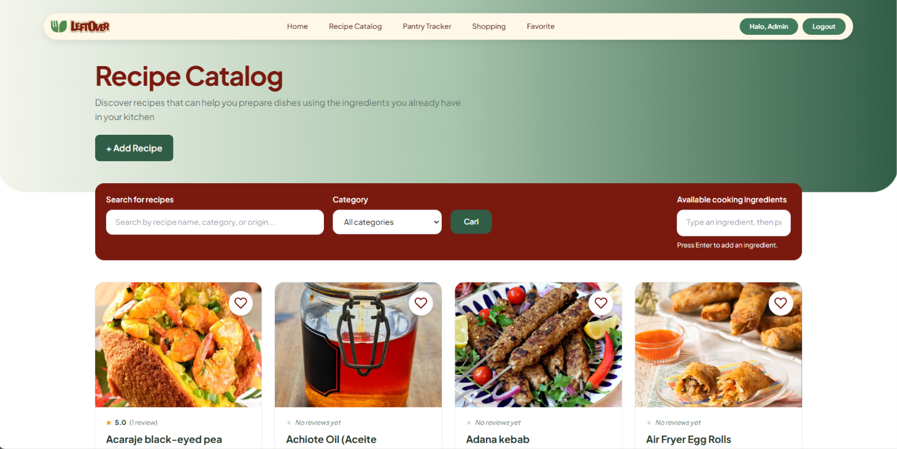
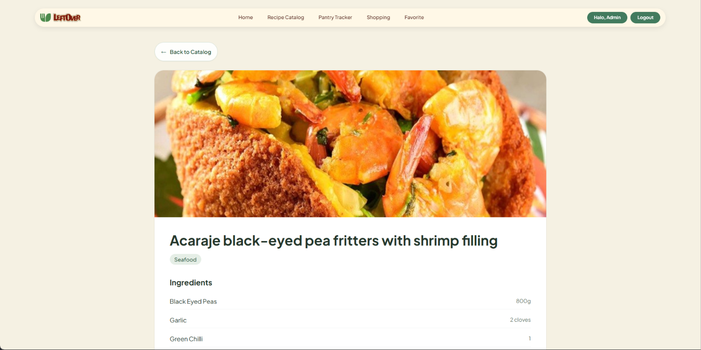
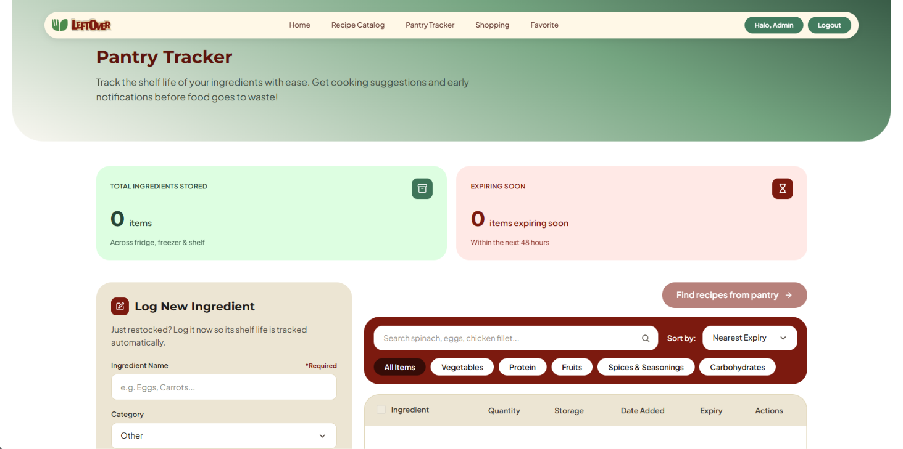
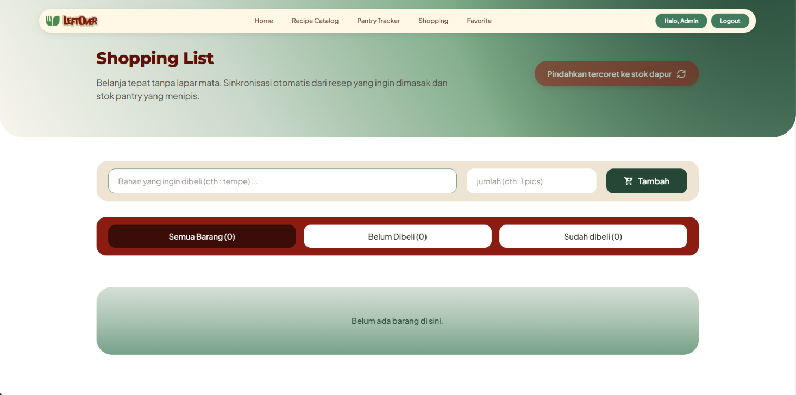
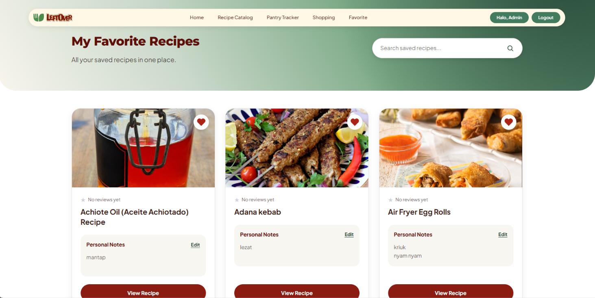

# LeftOver

**Ubah bahan makanan sisa menjadi hidangan berikutnya.**

LeftOver adalah platform rekomendasi resep berbasis web yang membantu mahasiswa, anak kos, dan keluarga memanfaatkan bahan makanan yang tersisa sebelum kedaluwarsa atau terbuang.

[**Aplikasi LeftOver**](https://raffa-zia-leftover.pws.cs.ui.ac.id) · [**Desain Figma**](https://www.figma.com/design/MVE4zOAzM8PyQj1AfHIKZM/LeftOver?node-id=1-2&t=YFxZ7RLrrGsnCGk6-1)

---

## Daftar Isi

- [Gambaran Umum Proyek](#gambaran-umum-proyek)
- [Target Pengguna](#target-pengguna)
- [Permasalahan yang Diatasi](#permasalahan-yang-diatasi)
- [Fitur](#fitur)
- [Peran Pengguna](#peran-pengguna)
- [Screenshot dan Demonstrasi](#screenshot-dan-demonstrasi)
- [Teknologi dan API](#teknologi-dan-api)
- [Panduan Instalasi](#panduan-instalasi)
- [Menjalankan Pengujian](#menjalankan-pengujian)
- [Modul Proyek dan Anggota Tim](#modul-proyek-dan-anggota-tim)
- [Desain Proyek](#desain-proyek)
- [Deployment](#deployment)

## Gambaran Umum Proyek

LeftOver membantu pengguna menemukan resep berdasarkan bahan makanan yang sudah tersedia di dapur mereka.

Banyak orang membeli sayuran, telur, bumbu, daging, dan bahan makanan lainnya dalam jumlah yang menyisakan sebagian bahan yang belum terpakai. Tanpa ide untuk mengolah sisa bahan tersebut, makanan berisiko membusuk dan menambah jumlah sampah makanan rumah tangga.

Melalui LeftOver, pengguna dapat menjelajahi resep, mencari resep berdasarkan bahan yang tersedia, dan merencanakan pemanfaatan bahan makanan yang sudah dimiliki.

## Target Pengguna

1. Mahasiswa.
2. Anak kos.
3. Keluarga.

## Permasalahan yang Diatasi

Sampah makanan sering kali terjadi akibat perencanaan makanan yang kurang baik dan kesulitan menemukan cara untuk mengolah bahan makanan yang tersisa.

LeftOver bertujuan membantu pengguna memanfaatkan bahan makanan yang tersedia, mengurangi sampah makanan yang dapat dihindari, dan merencanakan kebutuhan makanan dengan lebih efektif.

## Fitur

### 1. Katalog Resep (*Recipe Catalog*)

Menjelajahi resep, mencari berdasarkan nama atau kategori resep, serta memfilter resep berdasarkan bahan makanan yang tersedia, dan menambahkan resep.

### 2. Pelacak Persediaan (*Pantry Tracker*)

Mengelola persediaan bahan makanan dengan mencatat nama bahan, jumlah, satuan, dan perkiraan tanggal kedaluwarsa.

### 3. Daftar Belanja Pintar (*Smart Shopping List*)

Mengorganisasi bahan makanan yang perlu dibeli dan melacak bahan yang sudah dibeli.

### 4. Ulasan dan Penilaian (*Reviews and Ratings*)

Pengguna yang telah terautentikasi dapat membagikan pengalaman memasak, memberikan penilaian dari 1 hingga 5 bintang, serta mengelola ulasan dan penilaian milik mereka sendiri.

### 5. Resep Favorit (*Favorite Recipes*)

Menyimpan resep pilihan agar dapat diakses kembali dan menghapus resep dari daftar favorit jika sudah tidak diperlukan.


## Peran Pengguna

### Tamu (*Guest / Anonymous User*)

Tamu dapat menjelajahi resep publik, mencari dan memfilter katalog resep, serta melihat detail resep.

### Pengguna Terdaftar (*Registered User*)

Pengguna terdaftar memperoleh akses sebagai tamu serta dapat menggunakan fitur yang memerlukan autentikasi, termasuk pengelolaan persediaan bahan makanan, daftar belanja, resep favorit, ulasan, dan pembuatan resep, sesuai dengan aturan akses aplikasi.

## Screenshot dan Demonstrasi

Bagian ini menyediakan dokumentasi visual mengenai antarmuka LeftOver dan interaksi utama yang tersedia pada aplikasi.

### Halaman Utama (*Home Page*)



### Katalog Resep (*Recipe Catalog*)

Jelajahi berbagai resep dan temukan hidangan berdasarkan bahan makanan yang tersedia.



### Detail Resep (*Recipe Detail*)

Lihat informasi resep, daftar bahan, dan petunjuk memasak.



###  Pantry Tracker 

Pantau masa simpan bahan-bahan Anda dengan mudah. ​​Dapatkan saran masakan serta notifikasi lebih awal sebelum bahan makanan terbuang sia-sia!



###  Shopping 

Belanja tepat tanpa lapar mata. Sinkronisasi otomatis dari resep yang ingin dimasak dan stok pantry yang menipis.



###  Favorite

Semua resep yang Anda simpan di satu tempat




### Pencarian dan Filter Bahan Makanan

Demonstrasi berikut memperlihatkan cara pengguna mencari resep berdasarkan bahan makanan yang tersedia.


### Menambahkan resep makanan

Demonstrasi berikut memperlihatkan cara pengguna untuk menambahkan resep masakan.


### Memberikan review

Demonstrasi berikut memperlihatkan cara pengguna untuk memberikan rating dan review resep masakan.


### Menambahkan bahan bahan yang ada di dapur atau kulkas
Demonstrasi berikut memperlihatkan cara pengguna untuk memasukkan bahan yang tersedia di dapur yang nantinya akan diperlihatkan berapa sisa waktu bahan tersebut dari estimasi expired date.


### Menambahkan list bahan untuk belanja
Demonstrasi berikut memperlihatkan cara pengguna untuk menambahkan berbagai bahan makanan untuk perbelanjaan, serta memperlihatkan bagaimana sistem bisa memasukkan list bahan yang tercoret ke fitur pantry tracker.


### Menambahkan menambahkan resep favorite
Demonstrasi berikut memperlihatkan cara pengguna untuk menambahkan berbagai resep makanan kedalam daftar favorite mereka agar memudahkan saat ingin memasak, bisa disertai dengan notes (misal : ayam diganti dengan bebek, dll).


## Teknologi dan API

### Teknologi yang Digunakan (*Technology Stack*)

- **Backend:** Python dan Django.
- **Frontend:** HTML, CSS, dan Tailwind CSS.
- **Database:**
  - SQLite untuk pengembangan lokal (*development*).
  - PostgreSQL untuk lingkungan produksi (*production*) di PWS.
- **Interaksi asinkron:** HTMX, jika digunakan pada fitur terkait.
- **Penyimpanan gambar:** Cloudinary.

### API Publik (*Public API*)

LeftOver menggunakan [TheMealDB API](https://www.themealdb.com/api.php) sebagai sumber data resep.

Dokumentasi API: [https://www.themealdb.com/api.php](https://www.themealdb.com/api.php)

## Panduan Instalasi

Ikuti langkah-langkah berikut untuk menjalankan LeftOver secara lokal.

### Prasyarat

- Python dengan versi yang kompatibel dengan dependensi proyek.
- Git.
- Virtual environment.
- Konfigurasi environment variables dan database yang diperlukan.

### Instalasi

**1. Clone repositori**

Ganti `<URL_REPOSITORY>` dengan URL repositori Git yang digunakan oleh tim.

```bash
git clone <URL_REPOSITORY>
cd LeftOver
```

**2. Buat dan aktifkan virtual environment**

Pada Windows PowerShell:

```powershell
python -m venv env
.\env\Scripts\Activate.ps1
```

**3. Instal dependensi**

```bash
pip install -r requirements.txt
```

**4. Konfigurasikan environment variables**

Siapkan environment variables yang dibutuhkan oleh aplikasi, termasuk konfigurasi database dan kredensial Cloudinary jika diperlukan.

Jangan mengunggah secret key, kredensial, atau file konfigurasi produksi yang berisi informasi rahasia ke repositori.

**5. Jalankan migrasi database**

```bash
python manage.py migrate
```

**6. Jalankan server pengembangan**

```bash
python manage.py runserver
```

**7. Buka aplikasi**

Akses URL lokal yang ditampilkan pada terminal, biasanya:

`http://127.0.0.1:8000/`


## Menjalankan Pengujian

Untuk menjalankan pengujian pada modul Katalog Resep (*Recipe Catalog*), gunakan perintah:

```bash
python manage.py test recipes
```

Pengujian pada modul Katalog Resep mencakup pemeriksaan hak akses, validasi input, validasi URL, perlindungan CSRF, rollback transaksi, dan pembaruan bahan resep.

<!-- TODO: Perbarui jumlah test berdasarkan hasil pengujian terakhir. -->

## Modul Proyek dan Anggota Tim

| Modul | Anggota Tim |
|---|---|
| Katalog Resep (*Recipe Catalog*) | Raffa Zia Arya Putra — 2506619285 |
| Pelacak Persediaan (*Pantry Tracker*) | Zulfa Rahmi Nasution — 2506598324 |
| Daftar Belanja Pintar (*Smart Shopping List*) | Karyn Isabelle Dexter — 2506656860 |
| Ulasan dan Penilaian (*Reviews and Ratings*) | Elisia Catherine — 2506533570 |
| Resep Favorit (*Favorite Recipes*) | Alya Tsabita Imani — 2506620192 |

## Desain Proyek

Referensi desain antarmuka dan tampilan visual LeftOver tersedia melalui Figma.

[**Buka Desain LeftOver di Figma**](https://www.figma.com/design/MVE4zOAzM8PyQj1AfHIKZM/LeftOver?node-id=1-2&t=YFxZ7RLrrGsnCGk6-1)

## Deployment

LeftOver di-deploy pada platform PWS CS UI.

**Aplikasi aktif:** [https://raffa-zia-leftover.pws.cs.ui.ac.id](https://raffa-zia-leftover.pws.cs.ui.ac.id)

---

LeftOver hadir untuk membantu pengguna memasak dengan lebih bijak melalui pemanfaatan bahan makanan yang sudah tersedia.

## AI-Diclosure