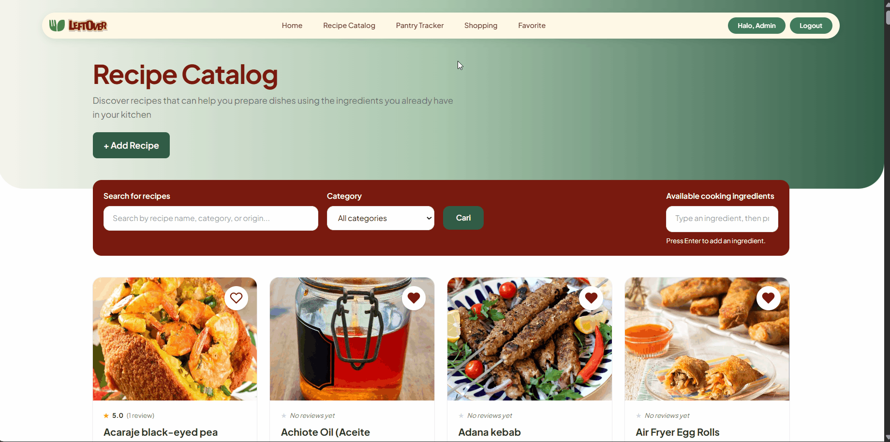
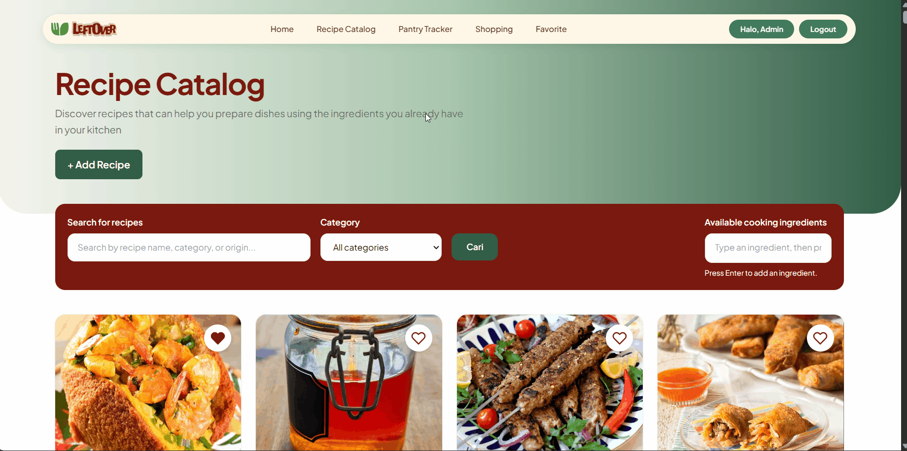
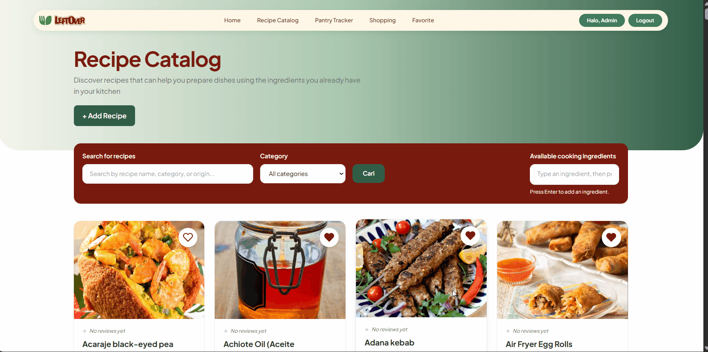
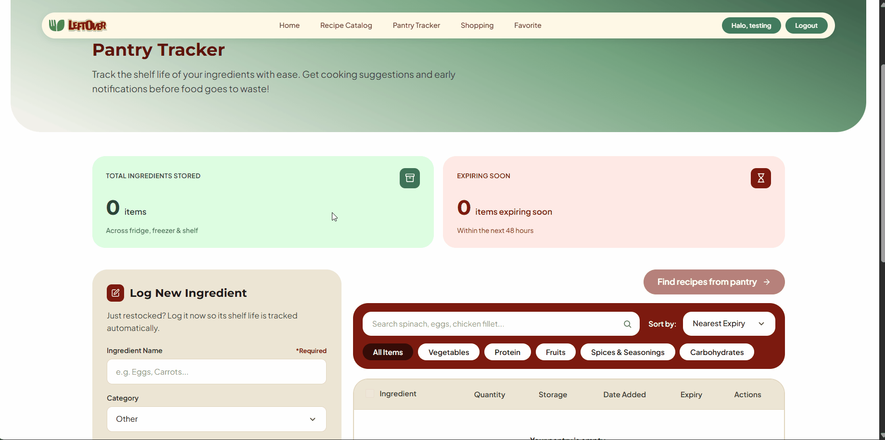
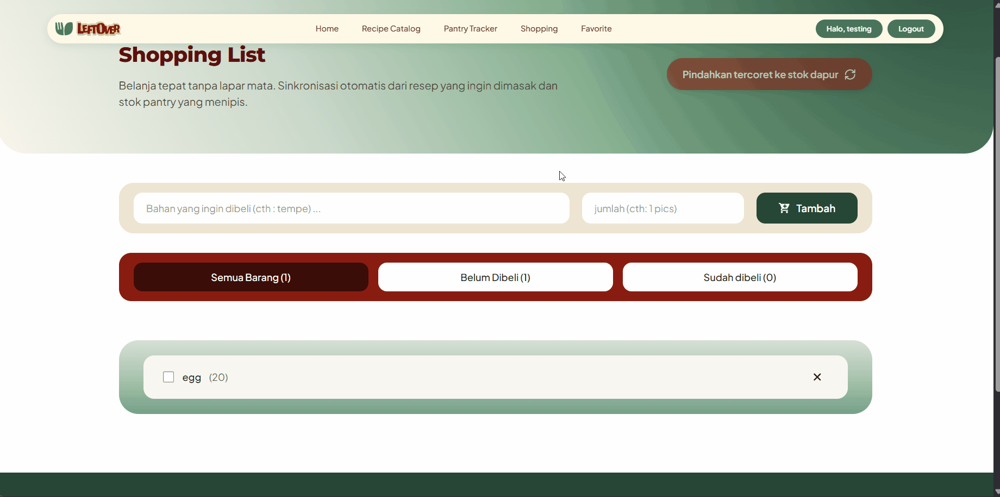
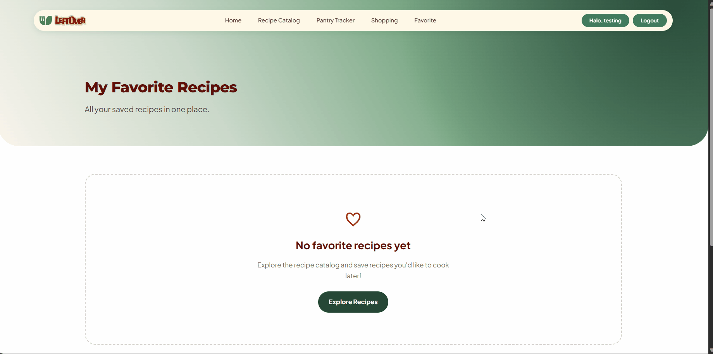

# LeftOver

**Ubah bahan makanan sisa menjadi hidangan berikutnya.**

LeftOver adalah platform rekomendasi resep berbasis web yang membantu mahasiswa, anak kos, dan keluarga memanfaatkan bahan makanan yang tersisa sebelum kedaluwarsa atau terbuang.

[**Aplikasi LeftOver**](https://raffa-zia-leftover.pws.cs.ui.ac.id) · [**Desain Figma**](https://www.figma.com/design/MVE4zOAzM8PyQj1AfHIKZM/LeftOver?node-id=1-2&t=YFxZ7RLrrGsnCGk6-1)

---

## Daftar Isi

- [Gambaran Umum Proyek](#gambaran-umum-proyek)
- [Target Pengguna](#target-pengguna)
- [Permasalahan yang Diatasi](#permasalahan-yang-diatasi)
- [Fitur](#fitur)
- [Peran Pengguna](#peran-pengguna)
- [Screenshot dan Demonstrasi](#screenshot-dan-demonstrasi)
- [Teknologi dan API](#teknologi-dan-api)
- [Panduan Instalasi](#panduan-instalasi)
- [Menjalankan Pengujian](#menjalankan-pengujian)
- [Modul Proyek dan Anggota Tim](#modul-proyek-dan-anggota-tim)
- [Desain Proyek](#desain-proyek)
- [Deployment](#deployment)

## Gambaran Umum Proyek

LeftOver membantu pengguna menemukan resep berdasarkan bahan makanan yang sudah tersedia di dapur mereka.

Banyak orang membeli sayuran, telur, bumbu, daging, dan bahan makanan lainnya dalam jumlah yang menyisakan sebagian bahan yang belum terpakai. Tanpa ide untuk mengolah sisa bahan tersebut, makanan berisiko membusuk dan menambah jumlah sampah makanan rumah tangga.

Melalui LeftOver, pengguna dapat menjelajahi resep, mencari resep berdasarkan bahan yang tersedia, dan merencanakan pemanfaatan bahan makanan yang sudah dimiliki.

## Target Pengguna

1. Mahasiswa.
2. Anak kos.
3. Keluarga.

## Permasalahan yang Diatasi

Sampah makanan sering kali terjadi akibat perencanaan makanan yang kurang baik dan kesulitan menemukan cara untuk mengolah bahan makanan yang tersisa.

LeftOver bertujuan membantu pengguna memanfaatkan bahan makanan yang tersedia, mengurangi sampah makanan yang dapat dihindari, dan merencanakan kebutuhan makanan dengan lebih efektif.

## Fitur

### 1. Katalog Resep (*Recipe Catalog*)

Menjelajahi resep, mencari berdasarkan nama atau kategori resep, serta memfilter resep berdasarkan bahan makanan yang tersedia, dan menambahkan resep.

### 2. Pelacak Persediaan (*Pantry Tracker*)

Mengelola persediaan bahan makanan dengan mencatat nama bahan, jumlah, satuan, dan perkiraan tanggal kedaluwarsa.

### 3. Daftar Belanja Pintar (*Smart Shopping List*)

Mengorganisasi bahan makanan yang perlu dibeli dan melacak bahan yang sudah dibeli.

### 4. Ulasan dan Penilaian (*Reviews and Ratings*)

Pengguna yang telah terautentikasi dapat membagikan pengalaman memasak, memberikan penilaian dari 1 hingga 5 bintang, serta mengelola ulasan dan penilaian milik mereka sendiri.

**Fitur & Implementasi Teknis:**
* **Asynchronous CRUD & DOM Manipulation:** Seluruh interaksi pengelolaan ulasan diproses menggunakan AJAX (*Client-Side Update*). Pengguna dapat menambah, mengedit, atau menghapus ulasan secara instan tanpa perlu memuat ulang (*reload*) halaman.
* **Live Aggregation & UI Updates:** Agregasi basis data tingkat lanjut (`Avg` dan `Count`) diimplementasikan untuk menyinkronkan total ulasan dan rata-rata bintang pada *header* detail resep secara *real-time* setiap kali terjadi perubahan data ulasan.
* **Cloudinary Image Integration:** Pengguna dapat melampirkan dokumentasi hasil masakan hingga maksimal 3 foto per ulasan. Integrasi dengan Cloudinary API mencakup validasi tipe MIME (JPG/PNG/WebP), batasan ukuran file (Maks 2MB), serta adanya pengelolaan siklus hidup gambar (penghapusan otomatis di *cloud* saat ulasan dihapus).
* **Robust Validation & Time Formatting:** Sistem divalidasi secara ketat untuk menolak review ganda (untuk 1 user) pada resep yang sama dan menangani format input yang tidak valid. Selain itu, tanggal publikasi ulasan dirender secara dinamis menggunakan kalkulasi waktu kustom (misalnya, *"Just now"*, *"1 minute ago"*).
* **High Test Coverage (98%):** Seluruh lapisan logika (Model, View, Form) serta *edge cases* telah diuji dengan cakupan 98%, termasuk penggunaan *mocking* untuk mensimulasikan dan mengamankan pemanggilan API pihak ketiga (Cloudinary) selama pengujian.

### 5. Resep Favorit (*Favorite Recipes*)

Menyimpan resep pilihan agar dapat diakses kembali dan menghapus resep dari daftar favorit jika sudah tidak diperlukan.


## Peran Pengguna

### Tamu (*Guest / Anonymous User*)

Tamu dapat menjelajahi resep publik, mencari dan memfilter katalog resep, serta melihat detail resep.

### Pengguna Terdaftar (*Registered User*)

Pengguna terdaftar memperoleh akses sebagai tamu serta dapat menggunakan fitur yang memerlukan autentikasi, termasuk pengelolaan persediaan bahan makanan, daftar belanja, resep favorit, ulasan & rating, dan pembuatan resep, sesuai dengan aturan akses aplikasi.

## Screenshot dan Demonstrasi

Bagian ini menyediakan dokumentasi visual mengenai antarmuka LeftOver dan interaksi utama yang tersedia pada aplikasi.

### Halaman Utama (*Home Page*)


### Katalog Resep (*Recipe Catalog*)

Jelajahi berbagai resep dan temukan hidangan berdasarkan bahan makanan yang tersedia.


### Detail Resep (*Recipe Detail*)

Lihat informasi resep, daftar bahan, dan petunjuk memasak.


###  Pantry Tracker 

Pantau masa simpan bahan-bahan Anda dengan mudah. ​​Dapatkan saran masakan serta notifikasi lebih awal sebelum bahan makanan terbuang sia-sia!


###  Shopping 

Belanja tepat tanpa lapar mata. Sinkronisasi otomatis dari resep yang ingin dimasak dan stok pantry yang menipis.


###  Favorite

Semua resep yang Anda simpan di satu tempat


### Pencarian dan Filter Bahan Makanan

Demonstrasi berikut memperlihatkan cara pengguna mencari resep berdasarkan bahan makanan yang tersedia.



### Menambahkan resep makanan

Demonstrasi berikut memperlihatkan cara pengguna untuk menambahkan resep masakan.



### Memberikan review

Demonstrasi berikut memperlihatkan cara pengguna untuk memberikan rating dan review resep masakan.



### Menambahkan bahan bahan yang ada di dapur atau kulkas
Demonstrasi berikut memperlihatkan cara pengguna untuk memasukkan bahan yang tersedia di dapur yang nantinya akan diperlihatkan berapa sisa waktu bahan tersebut dari estimasi expired date.



### Menambahkan list bahan untuk belanja
Demonstrasi berikut memperlihatkan cara pengguna untuk menambahkan berbagai bahan makanan untuk perbelanjaan, serta memperlihatkan bagaimana sistem bisa memasukkan list bahan yang tercoret ke fitur pantry tracker.



### Menambahkan menambahkan resep favorite
Demonstrasi berikut memperlihatkan cara pengguna untuk menambahkan berbagai resep makanan kedalam daftar favorite mereka agar memudahkan saat ingin memasak, bisa disertai dengan notes (misal : ayam diganti dengan bebek, dll).




## Teknologi dan API

### Teknologi yang Digunakan (*Technology Stack*)

- **Backend:** Python dan Django.
- **Frontend:** HTML, CSS, dan Tailwind CSS.
- **Database:**
  - SQLite untuk pengembangan lokal (*development*).
  - PostgreSQL untuk lingkungan produksi (*production*) di PWS.
- **Interaksi asinkron:** HTMX, jika digunakan pada fitur terkait.
- **Penyimpanan gambar:** Cloudinary.

### API Publik (*Public API*)

LeftOver menggunakan [TheMealDB API](https://www.themealdb.com/api.php) sebagai sumber data resep.

Dokumentasi API: [https://www.themealdb.com/api.php](https://www.themealdb.com/api.php)

## Panduan Instalasi

Ikuti langkah-langkah berikut untuk menjalankan LeftOver secara lokal.

### Prasyarat

- Python dengan versi yang kompatibel dengan dependensi proyek.
- Git.
- Virtual environment.
- Konfigurasi environment variables dan database yang diperlukan.

### Instalasi

**1. Clone repositori**

Ganti `<URL_REPOSITORY>` dengan URL repositori Git yang digunakan oleh tim.

```bash
git clone <URL_REPOSITORY>
cd LeftOver
```

**2. Buat dan aktifkan virtual environment**

Pada Windows PowerShell:

```powershell
python -m venv env
.\env\Scripts\Activate.ps1
```

**3. Instal dependensi**

```bash
pip install -r requirements.txt
```

**4. Konfigurasikan environment variables**

Siapkan environment variables yang dibutuhkan oleh aplikasi, termasuk konfigurasi database dan kredensial Cloudinary jika diperlukan.

Jangan mengunggah secret key, kredensial, atau file konfigurasi produksi yang berisi informasi rahasia ke repositori.

**5. Jalankan migrasi database**

```bash
python manage.py migrate
```

**6. Jalankan server pengembangan**

```bash
python manage.py runserver
```

**7. Buka aplikasi**

Akses URL lokal yang ditampilkan pada terminal, biasanya:

`http://127.0.0.1:8000/`


## Menjalankan Pengujian

Untuk menjalankan pengujian pada modul Katalog Resep (*Recipe Catalog*), gunakan perintah:

```bash
python manage.py test recipes
```

Pengujian pada modul Katalog Resep mencakup pemeriksaan hak akses, validasi input, validasi URL, perlindungan CSRF, rollback transaksi, dan pembaruan bahan resep.

Untuk menjalankan pengujian pada modul Ulasan dan Penilaian (*Reviews and Ratings*), gunakan perintah:

```bash
python manage.py test reviews
```
Pengujian pada modul Ulasan mencakup pemeriksaan hak akses pengguna (otorisasi tingkat objek), validasi input formulir (batasan nilai rating, jumlah maksimal, serta ukuran dan tipe gambar), pengujian logika perhitungan waktu dinamis, serta simulasi (mocking) pengunggahan dan penghapusan gambar melalui API pihak ketiga (Cloudinary) beserta penanganan error-nya.

## Modul Proyek Peranggota dan Anggota Tim

| Modul | Anggota Tim |
|---|---|
| Katalog Resep (*Recipe Catalog*) | Raffa Zia Arya Putra — 2506619285 |
| Pelacak Persediaan (*Pantry Tracker*) | Zulfa Rahmi Nasution — 2506598324 |
| Daftar Belanja Pintar (*Smart Shopping List*) | Karyn Isabelle Dexter — 2506656860 |
| Ulasan dan Penilaian (*Reviews and Ratings*) | Elisia Catherine — 2506533570 |
| Resep Favorit (*Favorite Recipes*) | Alya Tsabita Imani — 2506620192 |

## Modul Proyek Bersama
| Modul | Anggota Tim | Deskripsi Fitur Utama |
|---|---|---|
**Landing Page** (`main`) | Raffa Zia Arya Putra (2506619285), Zulfa Rahmi (2506598324) | Mengembangkan antarmuka *Landing Page* interaktif sebagai beranda utama untuk memperkenalkan fitur-fitur aplikasi LeftOver. |
**Autentikasi** (`auth`) | Elisia Catherine (2506533570) | Mengimplementasikan sistem keamanan dan manajemen sesi pengguna (Registrasi, Login, dan Logout) untuk melindungi akses fitur aplikasi. |

## Desain Proyek

Referensi desain antarmuka dan tampilan visual LeftOver tersedia melalui Figma.

[**Buka Desain LeftOver di Figma**](https://www.figma.com/design/MVE4zOAzM8PyQj1AfHIKZM/LeftOver?node-id=1-2&t=YFxZ7RLrrGsnCGk6-1)

## Deployment

LeftOver di-deploy pada platform PWS CS UI.

**Aplikasi aktif:** [https://raffa-zia-leftover.pws.cs.ui.ac.id](https://raffa-zia-leftover.pws.cs.ui.ac.id)

---

LeftOver hadir untuk membantu pengguna memasak dengan lebih bijak melalui pemanfaatan bahan makanan yang sudah tersedia.

## AI-Diclosure
<details>
<summary><h3>ZULFA RAHMI NASUTION - 2506598324</h3></summary>
1. Keterbatasan AI

Selama pengembangan LeftOver, AI digunakan untuk membantu penulisan kode, debugging, dan memberikan rekomendasi implementasi. Namun, terdapat beberapa keterbatasan:
- AI terkadang menghasilkan kode yang tidak sepenuhnya sesuai dengan struktur project dan kebutuhan aplikasi.
- AI kurang memahami perbedaan penamaan bahan antara input pengguna dan katalog resep TheMealDB, sehingga pencocokan bahan tidak selalu akurat.
- Kode yang dihasilkan AI tidak selalu mempertimbangkan edge cases, seperti data kosong, bahan kedaluwarsa, duplikasi data, dan kegagalan koneksi API.
- Solusi debugging dari AI terkadang hanya mengatasi gejala error tanpa menyelesaikan akar permasalahannya.

2. Perbaikan yang Dilakukan Secara Manual

Untuk mengatasi keterbatasan tersebut, dilakukan beberapa penyesuaian dan debugging secara manual:
- Mengembangkan sistem ingredient alias, synonym mapping, dan pencocokan singular/plural agar pencarian resep lebih akurat.
- Menambahkan API timeout, exception handling, caching, dan fallback menggunakan data resep lokal ketika TheMealDB tidak dapat diakses.
- Memperbaiki logika rekomendasi resep berdasarkan jumlah bahan yang cocok, tanggal kedaluwarsa terdekat, dan urutan alfabetis.
- Melakukan pemeriksaan ulang terhadap validasi form, relasi database, dan hasil operasi CRUD untuk memastikan data tersimpan dan ditampilkan dengan benar.

3. Kesimpulan

AI (chatGPT) berperan sebagai alat bantu selama proses pengembangan, bukan sebagai pengganti proses pengambilan keputusan developer. Seluruh kode yang dihasilkan tetap memerlukan pemeriksaan, penyesuaian, debugging, dan pengujian manual agar sesuai dengan kebutuhan dan fungsionalitas LeftOver.

Link Chat : https://chatgpt.com/share/6ae4178c-6b24-83ec-9e9d-9e15bdcef85a
</details>


<details>
<summary><h3>ELISIA CATHERINE - 2506533570</h3></summary>
Saya menggunakan AI tools berupa Claude. Dengan link chat berikut ini:
1. Gemini : https://share.gemini.google/Pov6I3DMDJF0
2. Claude : https://drive.google.com/file/d/1h1Etf1yuhPzJCwE11B5c-mgFLcjJqEjU/view?usp=sharing

Untuk link Claudenya sudah tidak bisa di share, tapi saya sempat screenshot untuk AI Disclosure jadi disertakan dengan link Google docs saja ya kak...

Selama pengembangan projek LeftOver, saya menggunakan source belajar UTS saya dari link Gemini, di sana ada pertanyaan-pertanyaan saya terkait materi UTS PBP yang tentunya menjadi fondasi saya untuk memahami pengerjaan di project ini. Jadi kalau ketika ada pertanyaan yang saya ingat pernah di tanyakan, saya akan buka kembali percakapan itu. Untuk Claude secara garis besar saya gunakan untuk mendeteksi kesalahan pada modul saya, dengan cara saya mengirimkan file file yang dibutuhkan untuk mengecek bug pada modul saya, lalu claude akan membuatkan pdf yang berisikan list revisi yang harus saya lakukan.

Walaupun sangat membantu, kode dari AI jelas tidak bisa langsung disalin dan saya tempel. Misalnya, AI sempat membuatkan kode untuk membenarkan bug yang ada di modul saya, namun yang diberikan belum 100% sesuai karena AI tidak memiliki seluruh data modul saya sehingga saya harus menyesuaikan lagi bagiannya dengan kode saya, lalu dicek secara manual melalui server lokal. Selain itu, AI juga masih tidak mengerti full-context dari model saya sehingga masih banyak code rekomendasi yang missed dan tidak perlu saya implementasikan ke dalam modul saya.

Oleh karena itu, saya tetap harus merapikan dan menyesuaikan kodenya secara manual. Saya memperbaiki kerangka kode dan detailnya pada modul resep buatan teman sekelompok (Raffa dan Alta). Saya juga merakit ulang blok pengujian logika waktu secara mandiri menggunakan datetime dan timezone bawaan Django untuk memastikan semua kemungkinan if-else teruji dengan benar. Lalu untuk code demo saya kemarin tidak saya hapus, karena menyadari kode tersebut juga merupakan revisi untuk bug yang ada di modul saya, Thank youuu kak Malikkk!!
</details>

<details>
<summary><h3>RAFFA ZIA ARYA PUTRA - 2506619285</h3></summary>

Selama proses pengembangan proyek LeftOver, saya menggunakan AI tools berupa ChatGPT (OpenAI) sebagai alat bantu dalam memahami konsep, mengembangkan fitur, melakukan debugging, serta mengevaluasi implementasi kode, khususnya pada modul Recipe Catalog.

**1. Penggunaan AI**

ChatGPT saya gunakan dalam beberapa tahapan pengembangan proyek, antara lain:
- Membantu memahami dan mengimplementasikan konsep Django, termasuk penggunaan views, models, templates, URL routing, dan integrasi API.
- Memberikan arahan dalam mengintegrasikan TheMealDB API untuk memperoleh dan menampilkan data resep pada aplikasi LeftOver.
- Membantu mengembangkan logika pencarian, filtering resep berdasarkan bahan, serta penyesuaian tampilan Recipe Catalog menggunakan HTML, CSS, dan Tailwind CSS.
- Membantu mengidentifikasi kesalahan pada kode, menganalisis error, dan memberikan alternatif solusi ketika fitur tidak berjalan sesuai harapan.
- Memberikan rekomendasi dalam perbaikan UI/UX, responsive design, serta konsistensi tampilan antarmodul.
- Membantu memahami penggunaan Git, pengelolaan branch, proses integrasi perubahan dari anggota tim, serta strategi deployment aplikasi ke PWS.

**2. Keterbatasan AI**

Meskipun membantu mempercepat proses pengembangan, AI memiliki beberapa keterbatasan:
- AI tidak selalu memahami keseluruhan struktur proyek dan implementasi yang telah dibuat oleh seluruh anggota tim, sehingga solusi yang diberikan terkadang tidak sesuai dengan kondisi kode aktual.
- Kode yang dihasilkan AI terkadang menggunakan struktur, nama variabel, URL, atau pendekatan implementasi yang berbeda dari proyek LeftOver.
- Rekomendasi terkait HTML dan CSS tidak selalu menghasilkan tampilan yang sesuai dengan desain yang diinginkan, sehingga masih diperlukan penyesuaian secara manual.
- AI terkadang memberikan solusi debugging yang belum menyelesaikan akar permasalahan atau justru memunculkan ketidaksesuaian pada bagian kode lainnya.
- Rekomendasi implementasi tidak selalu mempertimbangkan keterkaitan antarmodul, sehingga perubahan pada satu bagian aplikasi perlu diperiksa kembali agar tidak mengganggu fungsionalitas modul lain.

**3. Perbaikan yang Dilakukan Secara Manual**

Untuk mengatasi keterbatasan tersebut, saya melakukan pemeriksaan dan penyesuaian secara mandiri, di antaranya:
- Meninjau kembali kode yang dihasilkan AI dan menyesuaikannya dengan struktur serta kebutuhan aktual proyek LeftOver.
- Memeriksa implementasi integrasi TheMealDB API, termasuk proses pengambilan data dan penyesuaian data resep agar dapat ditampilkan sesuai kebutuhan aplikasi.
- Melakukan debugging secara langsung melalui server pengembangan lokal untuk memastikan fitur pencarian, filtering, navigasi, dan tampilan resep berjalan sebagaimana mestinya.
- Menyesuaikan HTML dan CSS secara manual agar tampilan Recipe Catalog konsisten dengan desain serta responsive pada berbagai ukuran layar.
- Melakukan pengujian ulang setelah perubahan kode untuk memastikan tidak terdapat error maupun regresi pada fitur yang sebelumnya sudah berjalan.
- Memeriksa hasil integrasi perubahan dari anggota tim dan memastikan aplikasi tetap berjalan dengan baik sebelum melakukan deployment ke PWS.

**4. Kesimpulan**

ChatGPT digunakan sebagai alat bantu dalam proses pembelajaran dan pengembangan proyek LeftOver, bukan sebagai pengganti pemahaman maupun pengambilan keputusan developer. Setiap rekomendasi dan kode yang dihasilkan AI tetap melalui proses evaluasi, penyesuaian, debugging, serta pengujian secara manual. Dengan demikian, implementasi akhir tetap didasarkan pada kebutuhan proyek, pemahaman terhadap kode, dan keputusan teknis yang dilakukan oleh developer.

Link Chat ChatGPT: https://chatgpt.com/share/6ae48e0e-3388-83ec-9e5c-587aef4477b6 dan https://chatgpt.com/share/6ae48e32-f1fc-83ec-8a57-aa0712271586

</details>